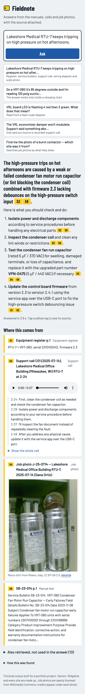
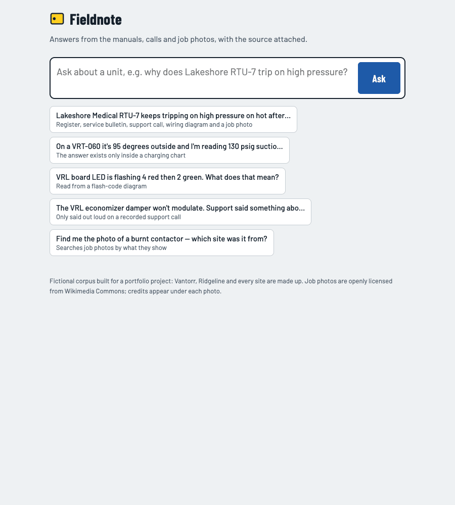
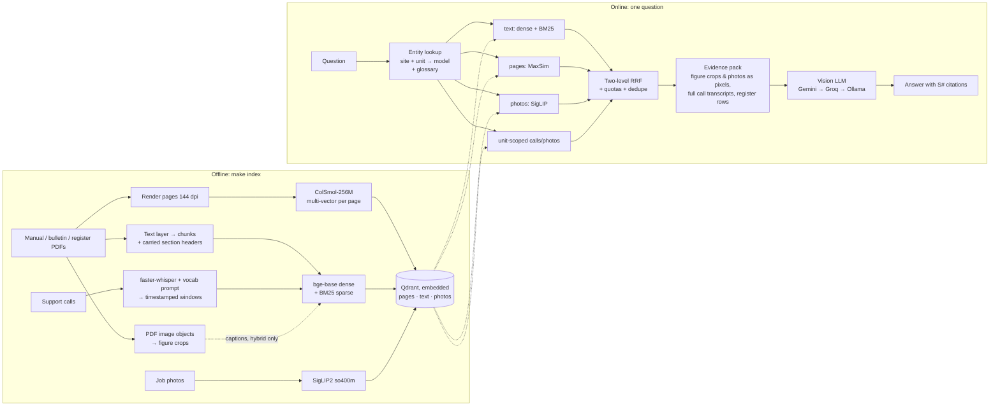

# Fieldnote

Multimodal RAG for HVAC field technicians. Ask a question on a roof; get a short answer where every claim
links to evidence you can check yourself: the cropped chart from the manual page, the ten seconds of the
support call where the fix was said out loud, or the job photo of the failed part.

Project page: [omkar-ku1karni.github.io/fieldnote](https://omkar-ku1karni.github.io/fieldnote/)

<p align="center">
  
  &nbsp;&nbsp;
  
</p>

The knowledge a technician needs lives in three places that don't look alike: charts and tables inside
equipment manuals (the answer is often a line on a graph, not a sentence), job-site photos (the evidence
is visual; the only text is a job number), and recorded support calls (the fix was said once and never
written down). Fieldnote retrieves across all three with a specialist encoder per modality, fuses the results
by rank, and has a vision model answer from the actual pixels.

> Before building it I set four pass/fail targets (the "ship gate" below): a 40-question eval where 15
> questions can't be answered from text alone, beat a caption-only baseline on those 15, every answer cites a
> page and a cropped image, and p95 latency under 6 s at k = 20.

---

## Results

<!-- RESULTS:START -->
### Ship gate

| Requirement | | Evidence |
|---|---|---|
| 40-question eval, 15 unanswerable from text alone | yes | 15 image-only questions whose values never appear in any text layer (validator + PDF text audit). Text-only retrieval can still reach the right page for 60% of them via the figure title, but the answer is only in the pixels |
| Beat the caption-only baseline on those 15 | yes | 76% vs 64% mean over 3 runs (runs: 11, 10, 13 vs 10, 9, 10 of 15) |
| Every answer cites a page and a cropped image | yes | figure citations show the crop + page; calls cite a timestamped clip; photos the photo |
| p95 latency < 6 s at k = 20 | yes | p95 5.0 s excluding provider rate-limit waits; 5.0 s as measured (0 of 40 requests throttled) |

### Retrieval (no LLM involved)

| Config | Image-only R@10 | All R@10 | All R@20 | MRR |
|---|---|---|---|---|
| Hybrid (shipped) | 1.00 | 0.96 | 0.96 | 0.80 |
| Pixels only | 0.87 | 0.91 | 0.94 | 0.74 |
| Caption-only baseline | 0.93 | 0.93 | 0.93 | 0.79 |
| Text only | 0.53 | 0.77 | 0.83 | 0.69 |
| Early fusion (one SigLIP space) | 0.47 | 0.48 | 0.58 | 0.28 |

### Answer accuracy, all 40 questions (one run each)

| System | Image-only (15) | Text (10) | Audio (8) | Multi-hop (7) | All (40) | Cites a gold source |
|---|---|---|---|---|---|---|
| Hybrid: caption keys for retrieval, pixels to the model (shipped) | 73% | 80% | 100% | 71% | 80% | 95% |
| Caption-only baseline: captions replace images | 67% | 80% | 100% | 57% | 75% | 95% |
| Pixels only, no captions anywhere (v2 run) | 80% | 70% | 88% | 57% | 75% | 88% |

### Ship-gate subset: the 15 image-only questions, repeated

The model isn't deterministic. Same inputs, and a question or two still flips between runs, so each system got three runs on this subset.

| System | Correct per run | Mean | Range |
|---|---|---|---|
| Hybrid (shipped) | 11/15, 10/15, 13/15 | 76% | 67%–87% |
| Pixels only | 10/15, 11/15, 11/15 | 71% | 67%–73% |
| Caption-only baseline | 10/15, 9/15, 10/15 | 64% | 60%–67% |

### Latency (shipped config, k = 20, M4 MacBook Air, hosted Gemini model)

Measured over all 40 questions at one request every 12 s. 0 request(s) waited on a provider rate limit; that wait is shown separately.

| Stage | p50 | p95 | max |
|---|---|---|---|
| Retrieval (lookup + 4 searches + fusion + packing) | 0.14 s | 0.21 s | 0.21 s |
| Generation (vision LLM call) | 2.49 s | 4.82 s | 5.46 s |
| End to end, as measured | 2.62 s | 4.96 s | 5.59 s |
| End to end, excluding rate-limit waits | 2.62 s | 4.96 s | 5.59 s |
| Rate-limit waits | 0.00 s | 0.00 s | 0.00 s |

Model: gemini-flash-lite-latest.

### How the image-only number moved (single runs; see the repeats above for noise)

| Version | Pixels only | Hybrid | Caption-only |
|---|---|---|---|
| v1: first run (3 page images in fused order, tags listed in one sentence) | 53% | – | 80% |
| v2: figure linking, interleaved labels, hybrid (page text cut at 900 chars) | 80% | 80% | 67% |
| final: full page text for pages without a figure | – | 73% | 67% |

<!-- RESULTS:END -->

All numbers are produced by `make eval` and rendered by `python -m fieldnote.report` into
[`eval/RESULTS.md`](eval/RESULTS.md), which also has every configuration, the first-run numbers, and a
per-question table. Nothing in this section is typed by hand.

---

## How it works



**Design decisions, and why**

| Decision | Choice | Why (and what was measured) |
|---|---|---|
| One space or one per modality? | Late fusion: ColSmol for page images, SigLIP2 for photos, bge + BM25 for text and transcripts | No single encoder is good at dense manual pages, natural photos and part numbers. Early fusion (everything in one SigLIP space) was measured: recall@20 0.58 vs 0.94–0.96 |
| How to merge rankings | Two-level reciprocal-rank fusion, then quotas (>= 3 photos, >= 4 pages in k = 20) | Scores from different encoders are not comparable; ranks are. Merging dense and BM25 first stops text getting two votes (that bug cost image recall in v0) |
| Manual pages | ColSmol late interaction over page images, no OCR or captions | Matches query tokens to the patches where "HPS open / close" is printed |
| Captions? | Hybrid: captions are an extra *retrieval key*; the model answers from the *pixels* | A caption is an excellent search key for a table and a lossy record of a curve. See results |
| "Lakeshore RTU-7" | Structured lookup against the equipment register, then unit-scoped search | Identifiers are not concepts. Removing it: multi-hop recall@20 0.92 -> 0.68 |
| Reranker | Off by default (MiniLM and bge-reranker measured) | MiniLM (web-trained) didn't help; bge-reranker +2 points recall@20 for ~1.5–2.5 s, and it can only rerank text |
| Calls | Whisper -> text retrieval; the whole transcript goes to the model; the clip is grounded to the cited sentence | Speech content, not sound events, holds the answer; facts are often a minute after the matching words |
| Answer model | Gemini flash-lite, Groq fallback, local Ollama with no key | Each was given the same chart: hosted models read 389–390 (truth 388.1); the local 7B read 430 |

The long version, with every decision, the debugging stories behind them, and where each number comes from, is in
[`docs/DESIGN.md`](docs/DESIGN.md).

---

## The data: synthetic on purpose

No public dataset has manuals, photos and calls about the same equipment, and real manuals are copyrighted. So
the corpus is generated from a seeded spec (`datagen/world.py`) for a fictional manufacturer, Vantorr
Climate Systems, and a fictional contractor with 6 sites and 34 units. That gives exact ground truth:

- Figure-only facts (charging-chart lines, pressure-switch setpoints, LED flash codes, sensor curves, wiring
  tables) are rendered into scanned-looking images and never appear in any text layer. That's checked by a
  validator on the LLM-written prose and by auditing every page's text after building the PDFs.
- Text facts are given verbatim to an LLM that writes the manual prose; it never sees figure values, so it
  cannot leak them.
- Call-only facts exist only in audio: 24 scripts voiced with Kokoro TTS, the technician side passed through
  a simulated phone line (band-pass, 8 kHz, μ-law, wind and hum), so Whisper makes realistic mistakes.
- Photos are 86 openly licensed Wikimedia Commons images (4 that questions depend on, 82 distractors), pinned
  by page id, with job metadata only and no descriptions. Credits in [`CREDITS.md`](CREDITS.md).
- Every eval answer is computed from the spec, never written by an LLM.

| | |
|---|---|
| Manuals, bulletins, register | 153 PDF pages, 38 figures |
| Photos | 86 (CC0 / public domain / CC BY / CC BY-SA) |
| Support calls | 24 calls, 75 minutes |
| Eval | 40 questions: 15 image-only, 10 text, 8 audio, 7 multi-hop |

---

## Run it yourself

Requirements: macOS or Linux, Python 3.12, [uv](https://docs.astral.sh/uv/), ~10 GB disk for models and data,
16 GB RAM. No API key is required; a free Gemini or Groq key makes answers faster and better.

```bash
git clone https://github.com/omkar-ku1karni/fieldnote.git && cd fieldnote
cp .env.example .env          # optional: GEMINI_API_KEY / GROQ_API_KEY
make setup                    # uv sync
make corpus                   # PDFs, call audio, photos (the LLM-written prose is already in the repo)
make index                    # ~30–45 min on an M4: Whisper + page/photo/text encoders
make eval                     # retrieval + answer evals, writes eval/RESULTS.md
make app                      # http://localhost:8000
```

No keys at all? Install [Ollama](https://ollama.com), `ollama pull qwen2.5vl:7b`, and Fieldnote falls back to
it automatically (expect ~30–60 s per answer and weaker chart reading, see above). On a 16 GB machine,
don't run the app, an eval and Ollama at the same time; the embedded index also allows one process at a time.

Docker: `docker compose up` serves the app from your built `data/` folder; `docker compose --profile local-llm up`
adds Ollama. The image is CPU-only (PyTorch CPU wheels on Linux). *The Docker setup has not yet been
build-tested; the native `make` path is the tested one.*

| Make target | What it does |
|---|---|
| `make spec figures questions prompts` | Regenerate the seeded world, figures, eval set, LLM prompts |
| `make content` | Validate the LLM-written prose in `data/content/_raw/` |
| `make corpus` | Content -> PDFs, audio, photos |
| `make index` | Build the three Qdrant collections |
| `make captions baseline-index` | Captions for the baseline and hybrid (cached in `eval/captions.json`) |
| `make eval` | Retrieval + generation evals |
| `make check-llm` | Verify each configured LLM can read a chart correctly |
| `make app` | Web app |

---

## Limitations

- Tuned on the test set. There is no held-out split; fixes after the first run were made after reading
  failures on the same 40 questions. First-run numbers are kept in `eval/results/v0`, `v1`, `v2`. Next step: a
  fresh question set written after freezing the system.
- Small and synthetic. 40 questions, one annotator, a fictional manufacturer. Real-manual performance is untested.
- Non-deterministic generator. Single questions flip between identical runs; the ship-gate subset is
  therefore reported over three runs.
- Provider rate limits. Hosted APIs can rate-limit; waits are measured and reported separately.
- Local model. The no-key path works but misreads charts (one curve off on the test chart).

## Repository

```
datagen/            seeded world, figures, PDFs, TTS, photos, eval questions, LLM prompts + validator
src/fieldnote/      ingest, encoders, retrieve, answer, llm, baseline, early_fusion, evaluate, report, app
eval/               questions.yaml, captions.json, results/ (every run), RESULTS.md
data/spec/          world.json, figures.json, photos.yaml/.json  (committed)
data/content/       LLM-written prose (committed);  data/generated, data/index (rebuilt, git-ignored)
docs/               design notes, plan, screenshots
```

Models: ColSmol-256M (MIT), SigLIP2 so400m (Apache-2.0), bge-base-en-v1.5 (MIT), faster-whisper small.en (MIT),
Kokoro-82M (Apache-2.0). Photos: see [`CREDITS.md`](CREDITS.md).
