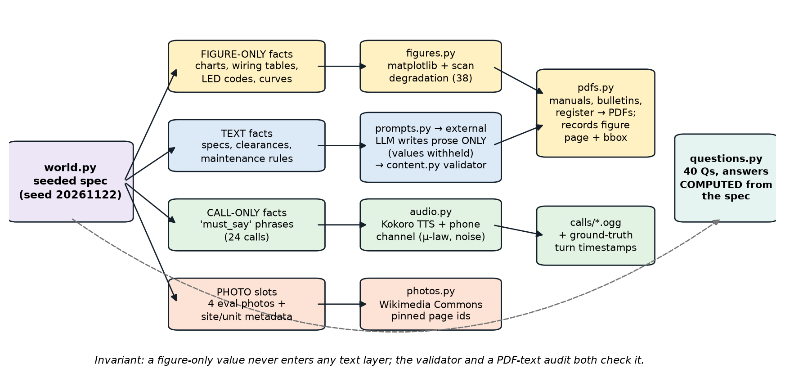
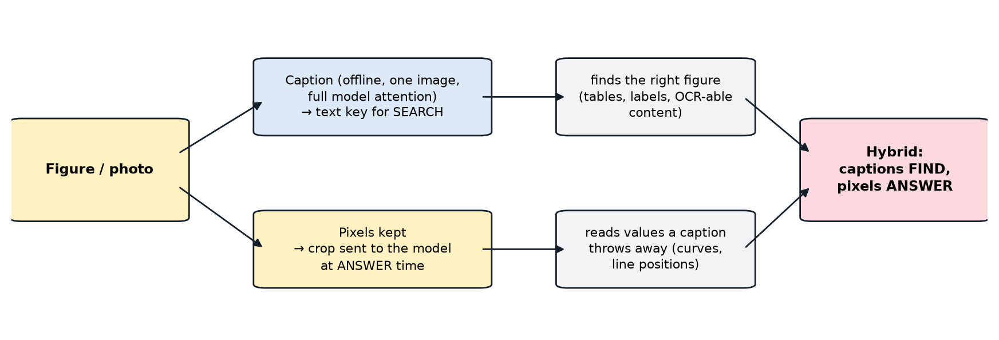
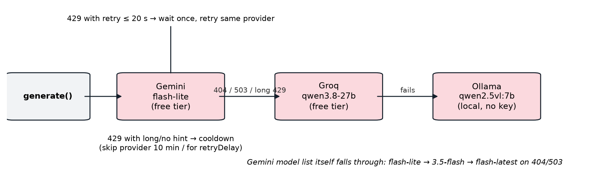
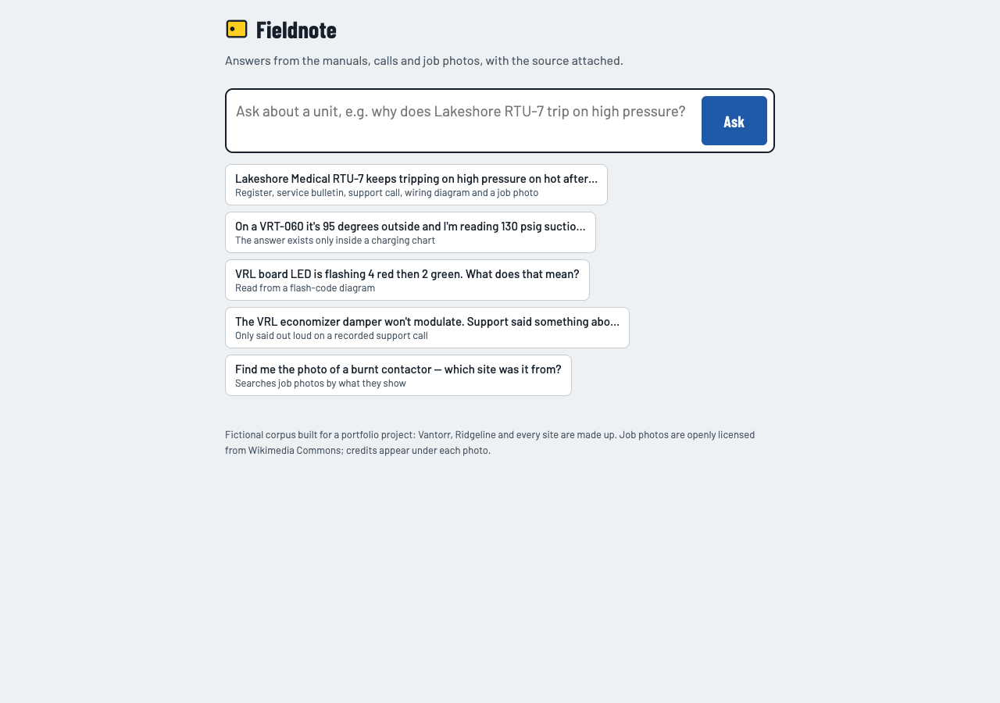

# Fieldnote design notes

How the corpus, retrieval, fusion, answering and evaluation are built, why each choice was made, and what broke along the way. Results live in [`eval/RESULTS.md`](../eval/RESULTS.md).

## Data: building a corpus you can trust

### Why a synthetic corpus, and why that is not cheating

No public dataset combines HVAC manuals, job photos and support calls about the same equipment. Real manufacturer manuals are copyrighted, so republishing their page images in a public repo or demo is not an option. More importantly for an *evaluation* project, real data gives you fuzzy ground truth: if a chart in a real manual says 412 psig, you only know that because you read it, and so did the model's pre-training data.

The design goal was a corpus where:

1. Every answer is known exactly, because code generated it.
2. The 15 image-only answers exist only in pixels, never in any PDF text layer, prose, or LLM prompt.
3. The numbers are not guessable from an LLM's general HVAC knowledge (fictional, model-specific values).
4. The material is realistic enough that retrieval is genuinely hard: noisy scans, long manuals, distractor photos, degraded phone audio.

> Note. Synthetic data controls contamination and gives exact ground truth; the cost is that real-world distribution shift is untested. Validate on a small set of real manuals before any deployment.

### The world spec: three classes of facts kept strictly apart

*Figure 2: How the corpus is generated. The seeded spec is the single source of truth; each class of fact can only reach the corpus through one channel.*

`datagen/world.py` builds everything from seed 20261122: a fictional manufacturer (Vantorr Climate Systems), a fictional contractor (Ridgeline Mechanical Services), five product series (VRT gas rooftop, VHP heat-pump rooftop, VCU condensing unit, VAH air handler, VRL large two-stage rooftop), 15 models, 6 customer sites, and 34 installed units with serials and controller firmware.

Each fact belongs to exactly one class:

| Class | Examples | Allowed channel | Never appears in |
|---|---|---|---|
| Figure-only | Charging-chart lines, HPS/LPS setpoints, MCA/MOP, LED flash codes, blower CFM tables, thermistor curves, altitude derate, line-set adder, wire colors | Rendered images only | Any text layer, LLM prompt, prose |
| Text | Factory charge, filter sizes, clearances, defrost options, maintenance rules | Manual prose (verbatim) | - |
| Call-only | Firmware 2.3 debounce bug, DIP-switch settings, part numbers like VLA-2 | Spoken audio only | Manuals, bulletins |
| Bulletin | Capacitor supersession VPN-0475, A2L mitigation duration | Service bulletins | Manuals, calls |

Several values were chosen deliberately to defeat model priors. Real 10 kΩ NTC thermistors with B = 3950 are common knowledge, so the VHP sensor is 15 kΩ with B = 3720. A real line-set adder of ~0.6 oz/ft past 15 ft would let a model "guess" the right answer, so Vantorr uses 0.71 oz/ft past 25 ft.

The charging chart is a linear model per unit, liquid = L0 + kT*(T_out - 95) + kS*(suction - 125), with per-model random coefficients: a realistic shape, but values you can't guess.

### Figures: making image-only questions honest

`datagen/figures.py` renders 38 figures with matplotlib: charging charts (suction on x, liquid on y, one line per outdoor temperature), wiring diagrams with an electrical-data table embedded in the image, LED flash-code tables drawn as red/green dots, blower tables and curves, sensor resistance curves on a log axis, an altitude-derate bar chart, and a line-set table. Each figure then gets "scan" degradation: a fraction of a degree of skew, slight blur, paper tint, Gaussian noise, JPEG at quality 88.

Two checks guarantee the image-only claim:

- Validator (`datagen/content.py`) rejects LLM prose containing figure-only patterns: numbers followed by psig/CFM/kΩ/amps, derate percentages near "altitude", wire-color phrases, LED patterns, any call-only part number, real brand names.
- PDF text audit: after building the PDFs, the text layer of every page is searched for every image-only answer. The only hits were coincidences (e.g. "630" appears as a site elevation), checked by hand in context.

The PDF builder (`datagen/pdfs.py`) records each figure's page and exact bounding box. This is *eval-only* ground truth; ingestion never uses it. It finds figures from the PDF's own image objects, the way it would on a real PDF.

### Prose by an LLM, facts by code

An external LLM wrote the manual prose (6–9k words per manual), three service bulletins and 24 call scripts from eight self-contained prompts generated by `datagen/prompts.py`. The prompts give the model the text facts verbatim and withhold the figure-only values entirely, so it can't leak a number it never saw. They explicitly forbid inventing part numbers, settings or specs, and require placeholders like `[[FIGURE:VRT-060-CC]]` exactly once each.

Validation caught real problems: one model used LaTeX for units, wrote checkbox lists, and described the charging chart's axes backwards (outdoor temperature on x). Those were fixed in the raw source files so the fix is reproducible.

> Trap. The tempting shortcut is to let the LLM also write the eval questions and answers. That gives you an eval whose ground truth is the model's own opinion, which is exactly the failure the Groundtruth project in this portfolio is about.

### Audio: support calls that sound like support calls

Each call script becomes audio with Kokoro-82M, a small open TTS model, one fixed voice per fictional person. The *recording model* is what makes it realistic: the agent is recorded on a clean wideband headset; the technician comes through a phone channel (brown-noise "wind" with gusts, a 55–62 Hz equipment hum at 14–22 dB SNR, a 300–3400 Hz band-pass, resampling to 8 kHz, and 8-bit μ-law companding), then everything is resampled to 16 kHz, the rate Whisper expects. Audio is saved as OGG Vorbis (24 calls, 75 minutes, 23 MB) with a JSON file of exact turn timestamps.

The degradation produces real ASR errors: "Vantor" for Vantorr, "Rijal" for Ridgeline, "VRT 6" for "V-R-T sixty", and, the one that later showed up in an answer, "debits" for "debounce".

### Photos: openly licensed, pinned, and deliberately uninformative metadata

Job photos come from Wikimedia Commons (Openverse was tried first but throttled anonymous clients to ~1 image/minute). Only CC0, public-domain, CC BY and CC BY-SA images were accepted. 325 candidates were reviewed by eye on contact sheets; 86 were kept: 4 "slot" photos that eval questions depend on (a capacitor with a blown top, a lint-matted coil, an iced heat-pump coil, a burnt contactor) and 82 realistic distractors (including a brand-new capacitor and a new contactor as hard negatives). Near-duplicates of slot photos were excluded so "which site was it?" has one right answer.

Each photo gets only job metadata: job id, site, unit, date, technician. No description. So "what failed on RTU-7?" can only be answered by looking at the pixels. The curated set is pinned by Commons page id in `data/spec/photos.yaml`; a fork re-downloads identical files. Photos are not stored in git; `CREDITS.md` lists every author and license.

### The equipment register

A two-page PDF generated by code: sites with elevations, and every unit's model, serial and firmware. It is what makes multi-hop questions possible ("Lakeshore RTU-7" -> VRT-060, serial 2310V00412, firmware 2.3 -> inside the SB-23-014 serial range -> firmware 2.3 has the debounce bug).

### The eval set: 40 questions with computed answers

| Category | n | What makes it that category | Answer type |
|---|---|---|---|
| Image-only | 15 | 11 figure reads (charts, wiring tables, LED dots, curves) + 4 photos | numeric ± tolerance or keyword groups |
| Text | 10 | Fact stated verbatim in manual or bulletin prose | keywords |
| Audio | 8 | Fact spoken only on a call | keywords |
| Multi-hop | 7 | Needs the register plus at least one other modality | rubric (LLM judge) or numeric |

Every question stores *gold evidence* as modality-specific references (figure id, verbatim fact string, call id, photo id, register row), which the eval maps to retrieval units at scoring time. Numeric tolerances follow what a human could read off the figure: ±8 psig on charging charts (the chart's own footnote), ±40 CFM on blower curves, ±3 °F on the log-scale sensor curve.

Questions are phrased the way a technician talks ("VCU-036 condenser, 85°F ambient, suction is 120 psig. Target liquid pressure?"), not the way a manual is indexed.
## How Fieldnote works, decision by decision

### Ingestion details

Page rendering. Every PDF page is rendered at 2x scale (144 dpi) with pypdfium2. Those images are what ColSmol sees and what the UI shows when a technician taps "Open the whole page".

Finding figures without cheating. The PDF builder knows where each figure is, but ingestion deliberately does not use that. It asks the PDF itself: pypdfium2 lists the page's image objects with their bounding boxes; anything covering at least 5% of the page is treated as a figure and cropped from the render. This works on any PDF whose figures are embedded raster images. Scanned PDFs (one big image per page) would need a layout-detection model such as DocLayout-YOLO instead.

Chunking with contextual headers. Page text is split into 180-word chunks with 40 words of overlap. Each chunk is embedded with a header: document title, the section heading in force where the chunk starts, and the page number. Headings are detected by pattern (`3.4 VRT-060 specifications`) and carried across page breaks. This came from a real failure: the VRT-060 specification table started on page 4 and continued on page 5, and the page-5 chunk (the one holding "3 filters, 20 x 25 x 2 in.") had no "VRT-060" anywhere in it.

Calls. Whisper segments are grouped into windows of at most ~40 seconds with one segment of overlap. Each window is embedded with a header built from the call's CRM-style metadata (date, site, unit, model, technician). That metadata is realistic, since a support system knows which account and unit a ticket is about, and it's what lets unit-scoped search find calls.

Collections. `pages` (one point per page, ColSmol multivector, MAX_SIM), `photos` (SigLIP2 vector + job metadata), `text` (manual chunks + call windows, bge dense + BM25 sparse). The modality tag lives on every point so filters and fusion can treat sources differently.

### Query-time pipeline

#### Entity lookup: a structured tool, not a vector search

Technicians name equipment the way the building does: "Lakeshore RTU-7". Vector search cannot know that RTU-7 at Lakeshore is a VRT-060 on firmware 2.3. So before searching, a deterministic lookup resolves site aliases (full name, first word, "Elm and 3rd") and unit tags (RTU/CU/AH + number) against the equipment register. Equipment-type words also resolve when unambiguous: "the condensing unit at Lakeshore" -> CU-1, because Lakeshore has exactly one.

The lookup does three things:

1. Query expansion. Appends the model id(s) ("VRT-060") to text and page queries.
2. Unit-scoped search. Runs extra searches over calls and photos *filtered* to that site and unit, the way a CMMS scopes records to an asset.
3. Evidence. The register row itself becomes a cited source.

Measured value: removing it dropped overall recall@20 from 0.94 to 0.84 and multi-hop recall@20 from 0.92 to 0.68 (v1 runs).

#### Glossary expansion

A short list of domain abbreviations is expanded both ways: "high-pressure switch" adds "HPS", "MCA" adds "minimum circuit ampacity". This came from a failure where the wiring diagram printed "HPS open / close (psig)" and the question said "high-pressure switch". It's a general fix that helps any HVAC question, not a patch for one test question.

#### Parallel searches

Four kinds of search run concurrently in a thread pool: hybrid text (dense + BM25), ColSmol pages, SigLIP photos, and unit-scoped calls/photos for each resolved unit. All models are loaded once, sequentially, on the main thread before the first parallel call.

#### Two-level fusion, dedupe and quotas

Level 1 merges dense and BM25 into a single hybrid text list (optionally reranked). Level 2 merges one list per modality with weighted RRF (text 1.0, pages 1.0, photos 0.8, lookup 2.0). Then:

- Dedupe to one slot per (modality, unit): five chunks from one page are one piece of evidence, not five.
- Quotas: at least 3 photos and 4 pages inside the final k = 20. Rank fusion alone let text crowd out the other modalities; quotas make modality coverage a stated policy instead of an accident of list counts.

#### Evidence packing: where retrieval meets the model

This step turned out to matter as much as retrieval itself. Rules in the final version:

- Figures go as pixels. A page hit with a figure sends the figure *crop* (not the whole page) so the model's image budget is spent on the chart.
- Text-to-figure linking. If a retrieved *text chunk* or *caption* sits on a page with a figure, that figure's crop is sent too. The text says "Figure 12. VCU-036 Cooling Charging Chart"; the pixels hold the answer.
- No pictures of text. A page without a figure contributes its text, not a screenshot of its text.
- Whole call transcripts. Calls are ~500 words, so the model gets the full timestamped transcript, not just the retrieved 40-second window. The fact it needs is often a minute after the words that matched.
- Caps: 6 text items, 4 figures, 3 photos, 3 calls, plus register rows.

#### Prompting the vision model

The system prompt sets four rules: answer only from evidence; lead with one short sentence that is the answer; cite every claim with [S#]; read values from images carefully and say which line/row/column was read, never guessing. Plain text only, no LaTeX (one model wrote `$5\text{ }\mu\text{F}$` until told not to; the UI also converts stray LaTeX).

Interleaving. Each image is sent immediately after its own label ("[S4] Job photo - Lakeshore RTU-7, 2025-07-14"), as alternating text and image parts. The first version listed tags in a sentence ("the attached images are, in order: S2, S4 ..."), and the model then mismatched photos to tags. It had the right photo and said there was none.

#### Citations and timestamp grounding

Citations are parsed from brackets, including grouped forms like "[S1, S4]" (the first parser only handled single tags and silently under-counted). For each cited call, Fieldnote finds the transcript segment with the most word overlap with *the sentences that cite that call*, and points the audio clip there (±1 segment). The clip endpoint slices the OGG and returns WAV, which plays everywhere including iOS Safari.

### The caption-only baseline (the "trap", built properly)

To make the comparison fair, the baseline is the trap done *well*:

- Every figure crop and photo is captioned once, offline, by the same vision model that answers questions, with a prompt that asks for all visible text, labels and numbers. 124 captions, all by `gemini-flash-lite-latest`, cached in `eval/captions.json` (committed, so the baseline reproduces with no API calls).
- Captions are embedded with the same text encoder and BM25 next to the same manual chunks and transcripts.
- The same lookup, fusion and generator are used. The only difference: no image encoders, and the model receives captions instead of pixels.

A weak baseline is the easiest way to manufacture a win; this one is deliberately strong.

### The hybrid: captions find, pixels answer

*Figure 6: The hybrid design that came out of the first results: use captions as an extra retrieval key, but answer from the pixels.*

The first full results showed captions are an excellent *retrieval key* (a caption of a table is basically OCR plus a description, and text search matches that very well) but a lossy *answer source* for continuous charts, where the value depends on where a line sits between gridlines. The hybrid keeps both strengths: caption points join the text collection, and any caption hit is resolved back to its figure crop or photo, which the model reads directly.
## Engineering: making it run, and what broke

### Infrastructure choices

Embedded Qdrant. `QdrantClient(path=...)` runs the vector database inside the Python process and stores collections in a folder (~60 MB here). It supports everything Fieldnote needs (dense vectors, sparse vectors with an IDF modifier, multivectors with MAX_SIM, payload filters) with no server to run. The catch, which bit three times: one process per folder. The app, an eval and a rebuild cannot share the index. Mitigations: a per-process singleton client created under a lock, a clear startup error in the app, and `FIELDNOTE_QDRANT_PATH` so an eval can run on a copy. At real scale you would run Qdrant as a server (it is one Docker container) and the restriction disappears.

Models on an M4 with 16 GB. ColSmol runs on the Apple GPU (MPS); SigLIP2 so400m, bge and the cross-encoders run on CPU. Measured warm query costs: ColSmol query encoding 70–450 ms, SigLIP text encoding ~120 ms, retrieval p95 ~0.25–0.35 s without a reranker. Loading ColSmol directly onto MPS in float16 segfaulted; loading on CPU in float32 and then moving it to MPS works.

Memory is the real budget. SigLIP2 so400m is ~4.5 GB in float32; ColSmol ~1 GB; bge 0.4 GB; Ollama's qwen2.5vl:7b ~6 GB. Two copies of the encoders (app + eval), or the local LLM plus indexing, pushed the machine into swap and turned a 5-second step into minutes. Rules adopted: never run the app and an eval at the same time on 16 GB; Ollama `keep_alive` of 2 minutes so the local model releases RAM; exclude the local model from latency runs.

LLM providers. One function, three backends: Gemini (`gemini-flash-lite-latest` first; `gemini-3.5-flash` and `gemini-flash-latest` as model-level fallbacks), Groq (`qwen/qwen3.8-27b`, vision-capable), and Ollama locally. All three were verified by giving each the same charging chart and checking the number it read: the two hosted models read 389–390 against a truth of 388.1; the local 7B model read 430, one line off, so it's the no-key fallback, not the default.

*Figure 7: Provider fallback with a circuit breaker. Short rate limits are waited out once; long ones put the provider on cooldown so later calls skip it instantly.*

Circuit breaker. A 429 with a short retry hint (<= 20 s) is waited out once on the same provider; a 429 with a long or missing hint puts that provider on cooldown (10 minutes or the hinted delay) and the next request skips straight to the next provider. Without it, every caption after Gemini's daily quota ran out would have wasted ~45 s on retries. Tested offline with fake providers before relying on it.

Docker. A CPU-only image (python:3.12-slim + uv). The non-obvious part: on Linux, PyTorch from PyPI pulls several GB of CUDA libraries. A `[tool.uv.sources]` override points torch/torchvision at the CPU wheel index *for Linux only*. It only applies to direct dependencies, so torch had to be declared directly even though nothing imports it directly. Compose mounts `data/` and `eval/` from the host and has an optional `local-llm` profile that starts Ollama.

Reproducibility contract. Committed: the seeded spec, the LLM-written prose (raw), the curated photo ids, the eval set, the cached captions, and all code. Regenerated deterministically: figures, PDFs, audio, photos (downloaded by pinned id), the index. A fork runs `make corpus index eval app`.

### The web app

FastAPI serves one static page (no build step) and four endpoints: `/api/ask`, `/api/examples`, `/api/clip/{call}?start&end` and `/media/...`. Design decisions, all driven by "a technician on a roof with a phone":

- Answer first, lead sentence in a condensed display face, then numbered steps.
- Yellow citation tags (inspection-tag yellow) in the text; tapping one scrolls to and flashes its evidence.
- Evidence in citation order; uncited evidence folded under "Also retrieved, not used in the answer".
- Figure crops at full width with "Open the whole page"; calls show the cited moment with timestamps and a playable clip; photos show author and licence.
- Light theme by default for sunlight, dark theme from the system setting, visible keyboard focus, reduced-motion respected.

*Figure 9: The start screen: one question box and example questions that each exercise a different kind of evidence.*

### Debugging stories

Each of these is a real problem from the build, written as symptom -> cause -> fix -> lesson.

#### "Text gets two votes"
Symptom: a correct ColSmol #1 page ranked 14th overall. Cause: dense and BM25 were separate RRF lists, so any text chunk found by both scored ~2/61 while the best page scored 1/61. Fix: two-level fusion (merge dense and BM25 into one list first). Result: image-only recall@5 0.60 -> 0.73, all-questions recall@20 0.91 -> 0.94. Lesson: RRF rewards consensus; make sure the number of lists per modality is a choice, not an accident.

#### The table that lost its header
Symptom: "What filters does a VRT-060 take?" never retrieved the right page. Evidence: page 5 began "Field Value / Cooling capacity 58,300 / ... Return air filters 3 filters, 20 x 25 x 2 in.", with no model name; the heading was on page 4. Fix: contextual chunk headers carried across page breaks. Only the bge reranker fully recovered it; recall for this one question is listed as a remaining failure.

#### The retriever was right and the answer was still wrong
Symptom: first generation run: image-only accuracy 53%, below the caption baseline's 80%, despite image-only recall@20 of 0.93. Evidence: per question, the right chart was in the top 20 but not among the three page images actually sent. For example, the VCU-036 chart was retrieved through its caption *text chunk* and a different page's image went to the model. Fix: text-to-figure linking and figure-only image packing. Lesson: evaluate the evidence pack, not just the ranked list.

#### Five images, wrong labels
Symptom: the model had the photo of the blown capacitor and said "the evidence does not specify". Cause: image tags were listed in a sentence ("images in order: S2, S4..."); with five images the model mis-associated them. Fix: interleave each label immediately before its image.

#### Thread-safety, twice
Symptom 1: `ImportError: cannot import name 'AutoModel'`, but only on the first query. Cause: two search threads triggered transformers' lazy imports at once. Fix: load every model sequentially before the first parallel search. Symptom 2: "storage folder already accessed by another instance" from *inside one process*. Cause: two threads raced to create the cached Qdrant client. Fix: create the client under a lock, on the main thread, before submitting searches.

#### The latency spike that wasn't retrieval
Symptom: p95 end-to-end 15.5 s against a 6 s gate. Evidence: the slow rows clustered right after one question that fell back to the local Ollama model (308 s); retrieval on the next five questions took ~11 s each. Cause: loading a 6 GB local model pushed the machine into swap. Fix: latency runs use hosted providers only, Groq requests sized under its limits; the local model is reported separately.

#### Small bugs that would have embarrassed a demo
- Citation parser missed grouped tags "[S1, S4]".
- An answer contained LaTeX units.
- The error message said "no language model answered" for an index-lock error (every `RuntimeError` was caught); LLM failures now raise their own `LLMUnavailable`.
- A wait loop used `pgrep -f "fieldnote.baseline"`, which matched its own command line and waited forever.
- Groq's vision model accepts at most three images; the fallback sent five.

### Honesty about tuning on the test set

There is no separate dev set: 40 questions is small, and every fix after the first run was made *after looking at failures on the same questions*. That inflates later numbers. The repo therefore keeps the first-run results (v0 retrieval, v1 generation) next to the current ones, every fix is described as a general rule (two-level fusion, contextual headers, glossary, quotas, figure linking) rather than a per-question patch, and the README states the bias. The right next step is a fresh, held-out question set written after the system was frozen.
